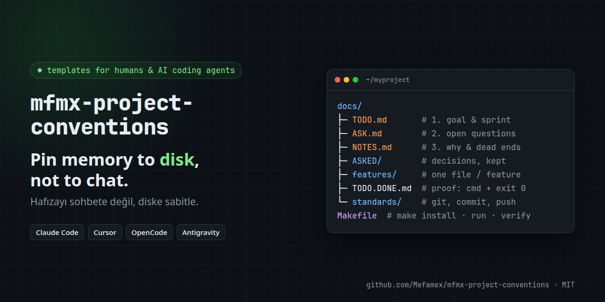

# mfmx-project-conventions

**🇬🇧 English** · **🇹🇷 [Türkçe](./README.tr.md)**

<p align="center"></p>

|              |                                                                |
| ------------ | -------------------------------------------------------------- |
| **Author**   | [Mefamex](https://github.com/Mefamex)                          |
| **Website**  | [https://mefamex.com](https://mefamex.com)                     |
| **License**  | MIT                                                            |
| **Created**  | 2026-11-07                                                     |
| **Updated**  | 2026-11-26                                                     |
| **Stack**    | Markdown, YAML, GNU Make, Bash (Git hook)                      |
| **Platform** | Language and platform agnostic; any Git repository             |
| **Status**   | Active Development                                             |

Project management, documentation and version-control templates (plus a guide) for both developers and AI coding agents (Claude Code, OpenCode, Antigravity, Cursor, etc.).
Core principle: **"Pin memory to disk, not to chat."** Copy the files as they are, or use this guide to fill in whatever your own project is missing.
This README itself follows the rules in [`docs/standards/README.STANDARDS.md`](./docs/standards/README.STANDARDS.md), so you can use it as an example for your own.

> **Language note:** The template files under `docs/` are currently written in **Turkish**. The structure, file names and workflow are language-neutral, and AI agents read and adapt them without issue (the agent prompt in [4.2](#42-setup-with-an-ai-agent) asks them to generate the files in your language). English template translations are on the roadmap; contributions are welcome.

> **Starting a session (developer or AI agent):** All working documents live under `docs/`. Every session reads [`docs/TODO.md`](./docs/TODO.md) first (Context Anchor, Quick Start, active sprint), then [`docs/ASK.md`](./docs/ASK.md) (open questions and the Decided gate), then [`docs/NOTES.md`](./docs/NOTES.md). When working on a single feature, open only that feature's file from [`docs/features/README.md`](./docs/features/README.md). If present, private notes in [`docs/NOTES.local.md`](./docs/NOTES.local.example.md) and the feature's `.local.md` file are read by full path too (they never enter the repo, search tools don't show them, and their content is never copied out). Rules live under [`docs/standards/`](./docs/standards/).

---

## Why?

AI coding agents forget everything when a session ends or the context window fills up. The usual result: the same question gets asked twice, a rejected approach gets tried again, and "done" is claimed without anything being run.

This repo moves that memory out of the chat and into a handful of plain Markdown files that live next to your code. Any agent (or human) can pick up the project cold by reading three files, in the same order, every time.

---

## 1. Architecture and Flow

How the files connect inside one work cycle (when a task is done, go back to `docs/TODO.md` for the next one):

```text
[ docs/TODO.md ] ──> [ Coding ] ──┬──> Uncertainty ──> [ docs/ASK.md ] ──answer──> [ docs/ASKED/<topic>.md ]
                                  ├──> Learned constraint / rejected path ──> [ docs/NOTES.md ]
                                  ├──> Current state of a feature ──> [ docs/features/<feature>.md ]
                                  ├──> Private context ──> [ docs/NOTES.local.md ] (not in repo)
                                  └──> [ make verify ] ──> [ docs/TODO.DONE.md ] ──> commit ──> approval ──> push
```

---

## 2. Key Capabilities

* **Prevents context drift:** The project's purpose sits in the Context Anchor at the top of `docs/TODO.md`, and the reasons behind decisions live in `docs/NOTES.md`. Even after a session reset, nobody starts from zero.
* **Stops guess-driven coding:** Critical dilemmas go into `docs/ASK.md` with their options. Decisions an agent makes on its own are logged in a "My Own Decision" table and stay auditable until approved.
* **Never forgets a decision:** Answered questions are kept in `docs/ASKED/<topic>.md` files and never deleted. The gate list at the end of `docs/ASK.md` is read every session, so no decision slips by; a changed decision is marked "Invalid".
* **Describes each feature in one file:** In the optional `docs/features/` folder, each feature's current state (how it works, settings, pitfalls, how to test it) is in a single file. The agent reads only the file of the feature it is working on.
* **Shuts down unverified claims:** A task is not done until the command that was run and its exit code are written into `docs/TODO.DONE.md`.
* **Catches leaks early:** The pre-commit hook scans only the added lines, and uses gitleaks if it is installed.
* **Same commands on every stack:** `make install`, `make run` and `make verify` mean the same thing in every project.

---

## 3. Tech Stack and Requirements

- **Required:** Git, GNU Make, Bash.
- **Optional:** [gitleaks](https://github.com/gitleaks/gitleaks) (secret scanning), your project's own linters / formatters.
- **Built on these standards:**
  - Conventional Commits v1.0.0 (extended with `add` / `update` types)
  - Atomic commits: refactors are committed separately from features / fixes
  - Keep a Changelog, plus an evidence rule (the test that was run and its exit code)
  - Self-documenting Makefile: plain `make` prints an aligned help menu
  - 12-Factor App: configuration can be overridden with environment variables

---

## 4. Installation and Quick Start

### 4.1. Manual setup

```bash
# 1. Clone the repo
git clone https://github.com/Mefamex/mfmx-project-conventions.git

# 2. Copy the root templates into your project root
cp mfmx-project-conventions/{CHANGELOG.md,config.example.yaml,.env.example,Makefile,.gitignore} ./myproject/

# 3. Copy the working documents (including the rule documents) under docs/
mkdir -p ./myproject/docs/ASKED
cp mfmx-project-conventions/docs/{TODO.md,ASK.md,NOTES.md,NOTES.local.example.md,STRUCTURE.md,TODO.DONE.md} ./myproject/docs/
cp mfmx-project-conventions/docs/ASKED/_SABLON.md ./myproject/docs/ASKED/
cp -r mfmx-project-conventions/docs/standards ./myproject/docs/

# 3b. (Optional) Feature docs folder, once the project has 4 or more features
mkdir -p ./myproject/docs/features
cp mfmx-project-conventions/docs/features/{README.md,_SABLON.md} ./myproject/docs/features/

# 4. Fill the Makefile in for your stack; make install creates config.yaml, .env and docs/NOTES.local.md from the templates if they are missing
cd myproject && make && make install
```

Then:

1. Fill in the Context and Purpose section at the top of `docs/TODO.md` and order your tasks. Write `docs/STRUCTURE.md` to match your project's folders.
2. Replace the `# [...]` lines in the `Makefile` with real commands (see the notes at the top of the file).
3. When you hit an architectural dilemma, write it into `docs/ASK.md` with its options. Move an answered question into a `docs/ASKED/<topic>.md` file using the 6 steps at the top of `docs/ASK.md`. Record constraints the system taught you and paths you rejected in `docs/NOTES.md`. If you use `docs/features/`, update a feature's file in every commit that changes that feature's behavior.
4. Move a finished task to the top of `docs/TODO.DONE.md` with a timestamp and test output; summarize user-facing results in `CHANGELOG.md`.
5. Make atomic commits following `docs/standards/GIT_STANDARDS.md`; never push without approval.

> `_SABLON.md` means "template" in Turkish.

### 4.2. Setup with an AI agent

Give your AI agent this prompt:

```text
Review every file and rule in the https://github.com/Mefamex/mfmx-project-conventions repository. Analyze my current project, then create the template files adapted to my project's stack and context (at the root: CHANGELOG.md, config.example.yaml, .env.example, Makefile, .gitignore; under docs/: TODO.md, ASK.md, NOTES.md, NOTES.local.example.md, STRUCTURE.md, TODO.DONE.md, ASKED/_SABLON.md; if the project has 4 or more features, also features/README.md and features/_SABLON.md). Write the generated files in English (or in the language I use with you). Use the rule documents in docs/standards/ (GIT_STANDARDS.md, PRE_COMMIT_CHECKLIST.md, PRE_PUSH_CHECKLIST.md, README.STANDARDS.md) as your reference. First show me the list of missing files and get my approval; when you are done, show me the output of `make` and `make verify`. Follow these rules in every step from now on.
```

---

## 5. Configuration

- Only the template `config.example.yaml` is tracked in the repo. Real settings live in `config.yaml`, which is in `.gitignore`; `make install` copies it from the example if it is missing.
- Precedence: **Environment variable (ENV) > `config.yaml` > in-code default.**
- ENV name: `<PREFIX>_<SECTION>_<KEY>` (e.g. `system.timeout_sec` → `APP_SYSTEM_TIMEOUT_SEC`).
- Duration and size fields carry their unit in the name: `timeout_sec`, `delay_ms`, `max_size_mb`.
- API keys, passwords and tokens are **never** written to `config.yaml`; they are read from environment variables or from a `.env` file that never enters the repo.

---

## 6. Usage and Commands

```bash
# Help menu (default target)
make

# Setup on a fresh clone / run / full verification before commit and push
make install
make run
make verify

# To install the Git hooks: save the scripts in docs/standards/PRE_COMMIT_CHECKLIST.md and
# PRE_PUSH_CHECKLIST.md under .git/hooks/ and make them executable
chmod +x .git/hooks/pre-commit .git/hooks/pre-push

# This repo's own integrity test (CI also runs it on every PR)
bash scripts/check.sh
```

---

## 7. Safety and Red Lines

1. **No guessing:** Where something is uncertain, nobody codes on an assumption; ask, or write it into `docs/ASK.md`.
2. **Push needs permission:** Local commits are free; `git push` runs only with explicit user approval. `--force` is forbidden.
3. **Evidence rule:** No task is done without `build`, `test` or `lint` output (exit code 0). The `make verify` output of an empty template Makefile is not evidence.
4. **Zero leftovers:** When work ends, temp files, processes and log leftovers are cleaned up (`make clean`).
5. **Zero leaks:** Secrets and personal data (phone numbers, IPs, SSIDs, passwords, tokens) never enter working files or Git history. Private context goes into `docs/NOTES.local.md`, which never enters the repo, and feature-specific private items go into `docs/features/<feature>.local.md`; their content is never moved into tracked files, commit / PR text or the CHANGELOG.

---

## 8. Project Structure (Root)

Files and folders in the root directory. For a map of all folders and important files: [`docs/STRUCTURE.md`](./docs/STRUCTURE.md).

- [`CHANGELOG.md`](./CHANGELOG.md) — Reader-facing summary of changes.
- [`config.example.yaml`](./config.example.yaml) — Configuration template; the real `config.yaml` is copied from it and never enters the repo.
- [`.env.example`](./.env.example) — Environment variable template; the real `.env` never enters the repo.
- [`Makefile`](./Makefile) — One-command lifecycle; plain `make` prints the help menu.
- [`.gitignore`](./.gitignore) — Secrets, local settings, caches, build output and OS leftovers.
- [`LICENSE`](./LICENSE) — MIT license.
- [`README.tr.md`](./README.tr.md) — Turkish version of this README.
- [`assets/`](./assets/) — Images used by the README and the repository's social preview.
- [`scripts/`](./scripts/) — This repo's own tools; not templates, not copied.
    - [`check.sh`](./scripts/check.sh) — Integrity test; run it with `bash scripts/check.sh`.
- [`.github/`](./.github/) — GitHub settings.
    - [`workflows/check.yml`](./.github/workflows/check.yml) — CI that runs `scripts/check.sh` on every PR and on every push to `main`.
- [`docs/`](./docs/) — All working documents and rules.
    - [`TODO.md`](./docs/TODO.md) — Entry gate: Context Anchor, Quick Start, active sprint and backlog.
    - [`ASK.md`](./docs/ASK.md) — Open questions, "My Own Decision" records awaiting approval, and the Decided gate at the end.
    - [`NOTES.md`](./docs/NOTES.md) — Technical memory: why decisions were made, rejected paths, measured limits.
    - [`NOTES.local.example.md`](./docs/NOTES.local.example.md) — Private notes template; the real `docs/NOTES.local.md` never enters the repo.
    - [`STRUCTURE.md`](./docs/STRUCTURE.md) — Map of all folders and important files.
    - [`TODO.DONE.md`](./docs/TODO.DONE.md) — Evidence-backed map of finished work (newest first).
    - [`ASKED/`](./docs/ASKED/) — Permanent, per-topic decision records of answered questions; template: [`_SABLON.md`](./docs/ASKED/_SABLON.md).
    - [`features/`](./docs/features/) — (Optional) Per-feature current-state documents; index: [`README.md`](./docs/features/README.md), template: [`_SABLON.md`](./docs/features/_SABLON.md).
    - [`standards/`](./docs/standards/) — How to work: Git standards, commit / push checklists, README standard.

---

## 9. License

[MIT](./LICENSE) — [Mefamex](https://github.com/Mefamex)
